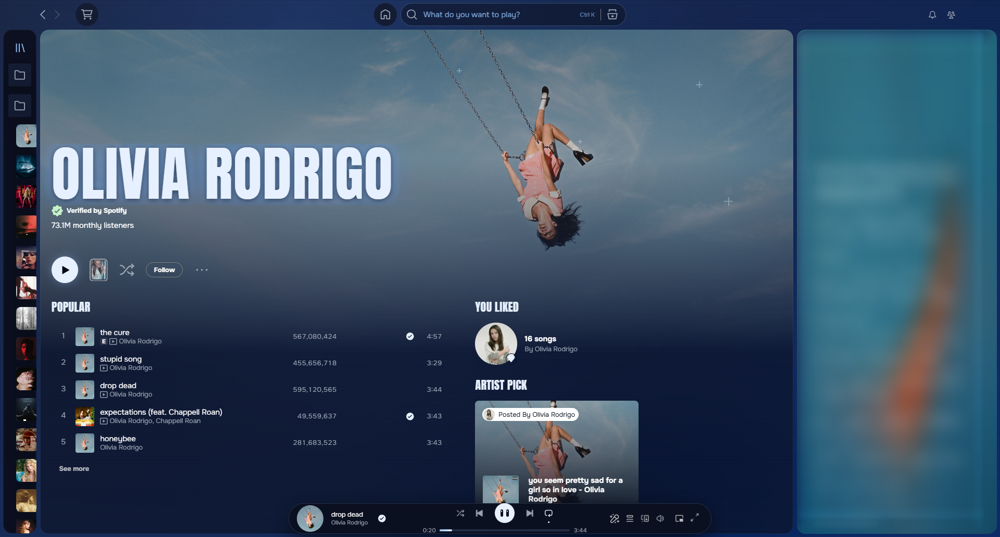
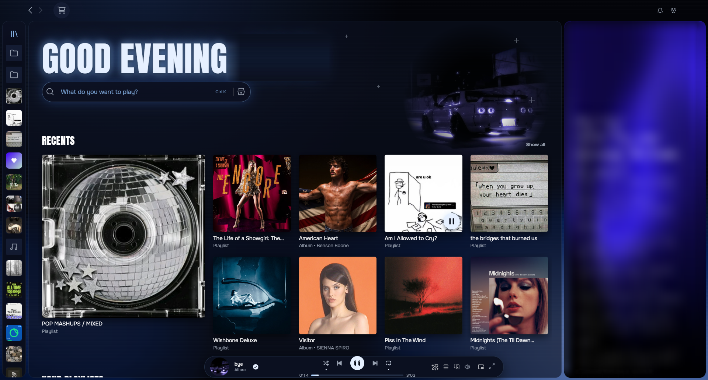
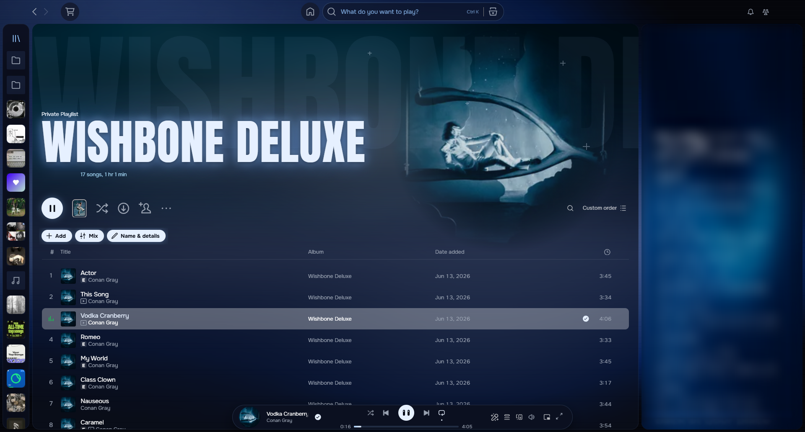
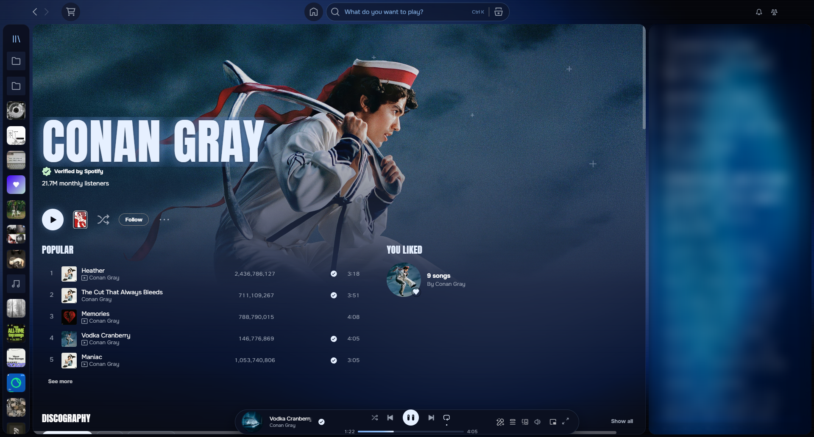

# Vitral

A Spicetify theme for Spotify desktop in five colors: Dark Blue, Pink, Green, Purple and Amber. The album art lights the window from behind glass, and the home page is rebuilt around a large greeting and search bar.

*[Versión en español más abajo](#español)*

## Screenshots






The play button watches your cursor:


## Features

- **Five color palettes** in one theme: pick yours in the dropdown at the top of the Marketplace
- **Home page:** greeting in your language, the current cover fading into the background, and a search bar that glides to the top bar as you scroll
- **Recents mosaic and playlist columns** instead of side-scrolling rows; promotional shelves are hidden
- **Large fading photo** on playlist, album and artist pages
- **Floating pill player** that grows with extra buttons, with a volume slider that opens on hover
- **Slim library rail** that opens on hover without moving the page
- **Play button eyes** that follow your cursor and blink while music plays
- Works in any Spotify language, with fallback fonts for non-Latin scripts

## Optional integrations

Vitral works on its own and needs no extensions. If you use any of these, it adapts to them:

- **[Spicy Lyrics](https://github.com/Spikerko/spicy-lyrics)** by Spikerko: lyrics take the theme's font, background and blue karaoke glow
- **[Mix Lyrics](https://github.com/SrPictus/mix-lyrics)**: both songs' lyrics during a mix get the same look
- **No Controls** by ohitstom: if you bring the window buttons back with F8, they overlap the profile picture

## Requirements

- [Spicetify](https://spicetify.app) 2.x with `inject_theme_js` enabled (the default)
- Developed and tested on Windows with Spotify 1.3.6 and Spicetify 2.46

## Install

Copy this folder to `%APPDATA%\spicetify\Themes\Vitral` on Windows, or `~/.config/spicetify/Themes/Vitral` on macOS and Linux. Then run:

```bash
spicetify config current_theme Vitral color_scheme "Dark Blue" inject_css 1 replace_colors 1 inject_theme_js 1
spicetify apply
```

## Known limits

- The theme uses some of Spotify's internal class names, so a Spotify update can break parts of it. The home search bar and the library rail are the most exposed.
- Hover tooltips on the player buttons appear after a short pause on purpose, to keep the app responsive.
- Tested in Spanish, English and Japanese. Right-to-left languages have not been tested.

## Uninstall

```bash
spicetify config current_theme marketplace color_scheme " "
spicetify apply
```

## License

MIT. See [LICENSE](LICENSE).

---

## Español

Tema de Spicetify para Spotify de escritorio en cinco colores: Dark Blue, Pink, Green, Purple y Amber; se elige en el desplegable de Marketplace. La carátula ilumina la ventana desde detrás del vidrio, y el inicio se rehace alrededor de un saludo grande y el buscador.

**Incluye:** inicio con saludo en tu idioma, mosaico de recientes, foto grande que se desvanece en playlists, álbumes y artistas, reproductor en píldora flotante, lista lateral compacta y ojos en el botón de play que siguen al cursor.

**Integraciones opcionales:** Vitral funciona solo y no necesita ninguna extensión. Si usas Spicy Lyrics o Mix Lyrics, las letras toman la fuente, el fondo y el brillo azul del tema. También es compatible con No Controls: si recuperas los botones de ventana con F8, se montan sobre la foto de perfil.

**Instalación:** copia esta carpeta en `%APPDATA%\spicetify\Themes\Vitral` (Windows) o `~/.config/spicetify/Themes/Vitral` (macOS y Linux), y ejecuta los comandos de arriba.

**Límites:** usa nombres internos de Spotify, así que una actualización puede romper partes del tema. Probado en Windows, en español, inglés y japonés; los idiomas de derecha a izquierda no están probados.
