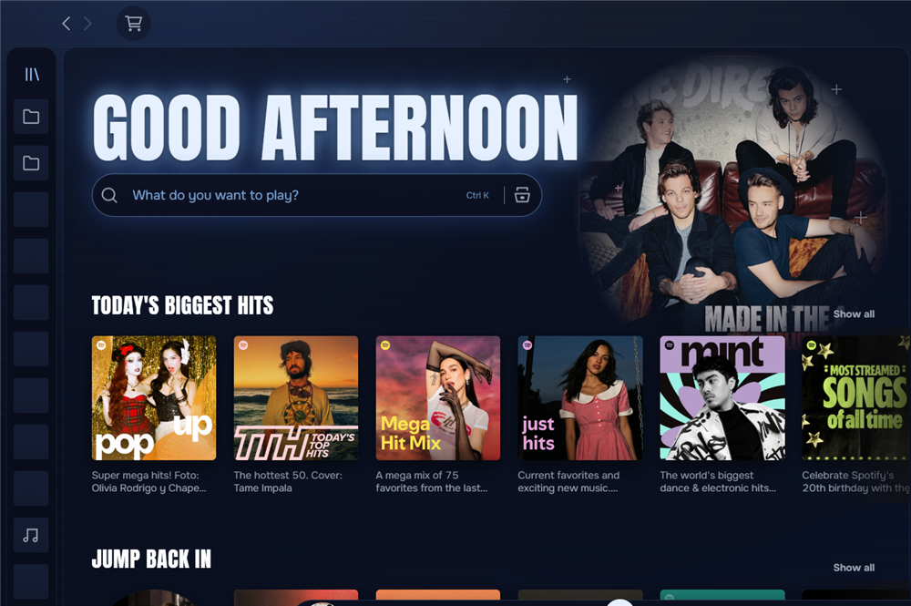
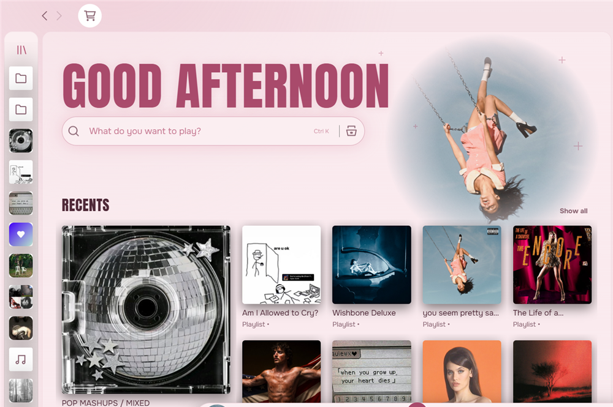
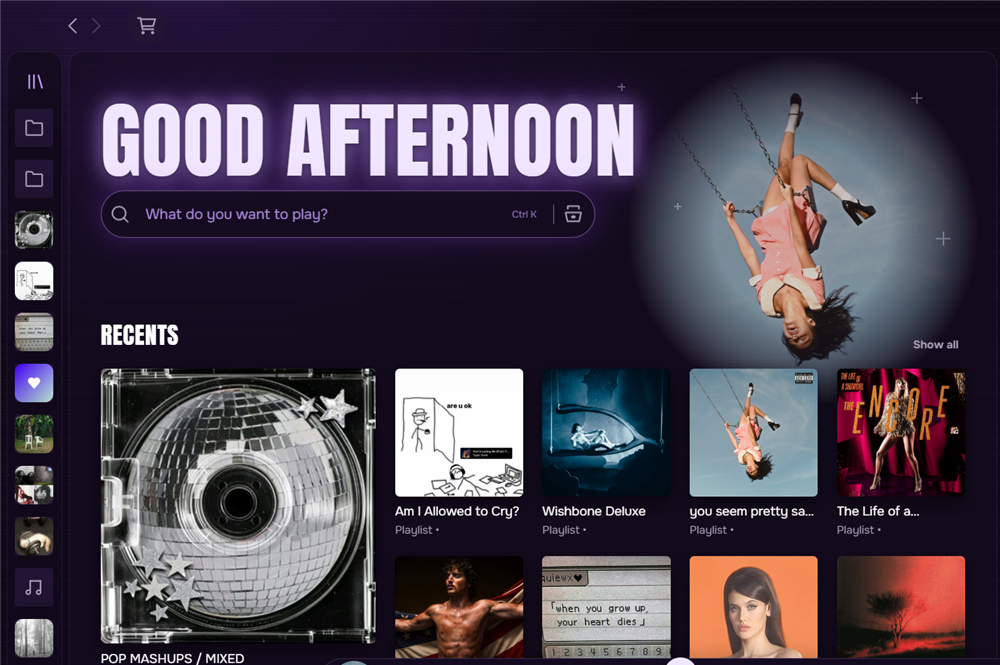
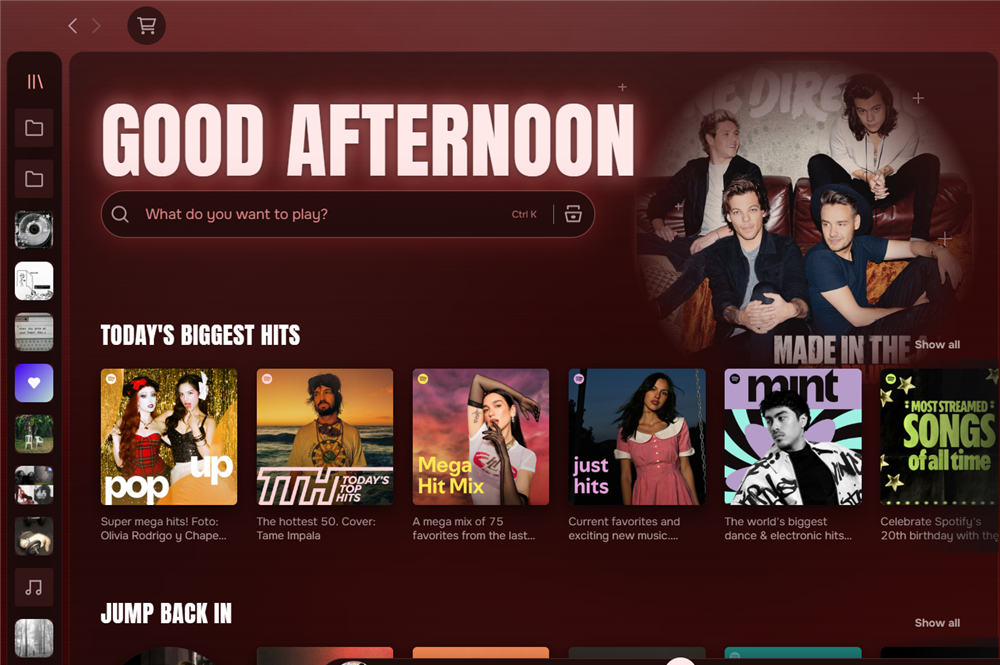
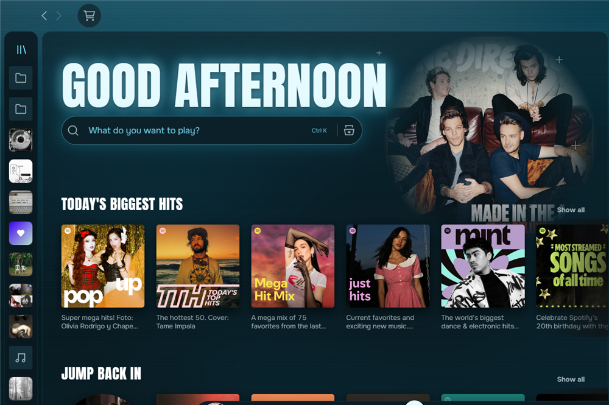
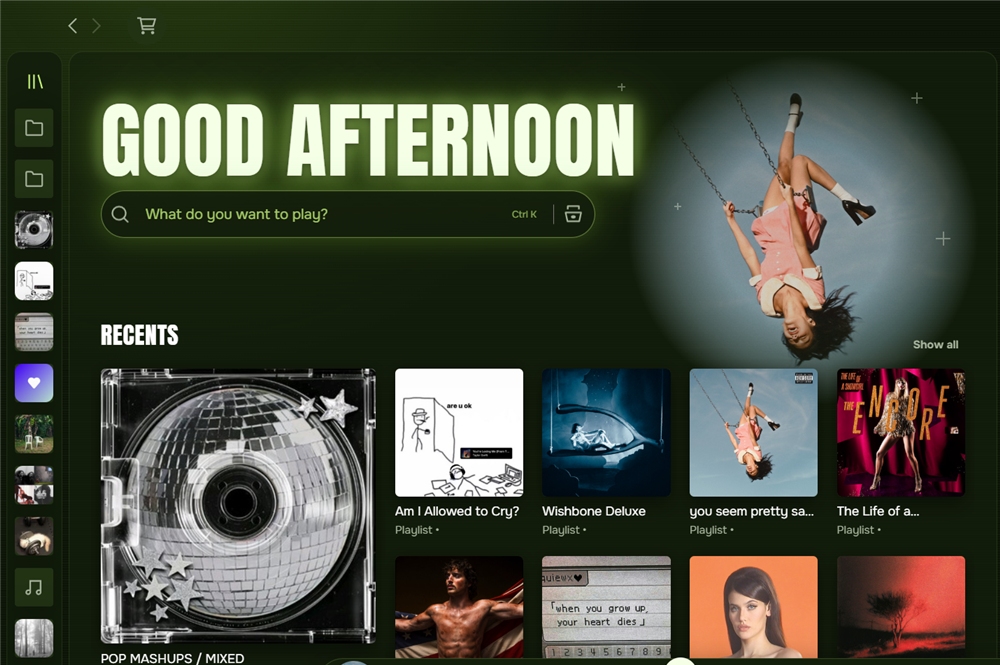
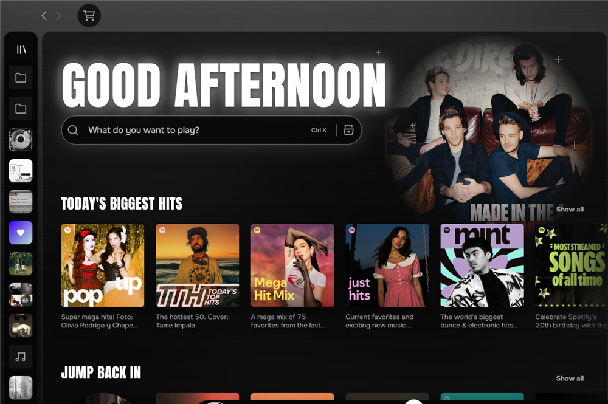
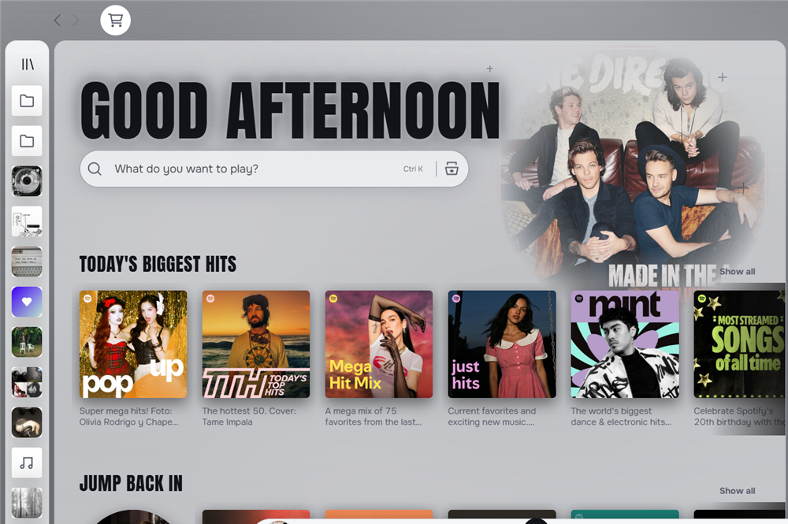

# Vitral

A Spicetify theme for Spotify desktop in eight colors: Dark Blue, Pink, Purple, Red, Cyan, Lime, Black and White. The background stays in the color you pick, and the home page is rebuilt around a large greeting and search bar.

*[Versión en español más abajo](#español)*

## Colors

Pick one in the dropdown at the top of the Marketplace.

| | |
|:---:|:---:|
| **Dark Blue**<br> | **Pink**<br> |
| **Purple**<br> | **Red**<br> |
| **Cyan**<br> | **Lime**<br> |
| **Black**<br> | **White**<br> |

## Screenshots


The play button watches your cursor:


## Features

- **Eight color palettes** in one theme: pick yours in the dropdown at the top of the Marketplace
- **Home page:** greeting in your language, the current cover fading into the background, and a search bar that glides to the top bar as you scroll
- **Recents mosaic and playlist columns** instead of side-scrolling rows; promotional shelves are hidden
- **Large fading photo** on playlist, album and artist pages
- **Floating pill player** that grows with extra buttons, with a volume slider that opens on hover
- **Slim library rail** that opens on hover without moving the page
- **Play button eyes** that follow your cursor and blink while music plays
- Works in any Spotify language, with fallback fonts for non-Latin scripts

## Optional integrations

Vitral works on its own and needs no extensions. If you use any of these, it adapts to them:

- **[Spicy Lyrics](https://github.com/Spikerko/spicy-lyrics)** by Spikerko: lyrics take the theme's font, background and blue karaoke glow
- **[Mix Lyrics](https://github.com/SrPictus/mix-lyrics)**: both songs' lyrics during a mix get the same look
- **No Controls** by ohitstom: if you bring the window buttons back with F8, they overlap the profile picture

## Requirements

- [Spicetify](https://spicetify.app) 2.x with `inject_theme_js` enabled (the default)
- Developed and tested on Windows with Spotify 1.3.8 and Spicetify 2.46

## Install

### Marketplace (recommended)

Open the **Marketplace** in Spotify, go to the **Themes** tab, search for **Vitral** and click **Install**. Pick a color in the dropdown at the top of the Marketplace. It updates on its own.

### Manual, on Windows

In PowerShell:

```powershell
$dir = "$env:APPDATA\spicetify\Themes\Vitral"; New-Item -ItemType Directory -Force $dir | Out-Null; foreach ($f in "user.css", "color.ini", "theme.js") { Invoke-WebRequest -UseBasicParsing "https://raw.githubusercontent.com/SrPictus/vitral/main/$f" -OutFile "$dir\$f" }
```

```powershell
spicetify config current_theme Vitral color_scheme "Dark Blue" inject_css 1 replace_colors 1 inject_theme_js 1
```

```powershell
spicetify apply
```

### Manual, on macOS and Linux

```bash
mkdir -p ~/.config/spicetify/Themes/Vitral && for f in user.css color.ini theme.js; do curl -fsSL "https://raw.githubusercontent.com/SrPictus/vitral/main/$f" -o ~/.config/spicetify/Themes/Vitral/$f; done
```

```bash
spicetify config current_theme Vitral color_scheme "Dark Blue" inject_css 1 replace_colors 1 inject_theme_js 1
```

```bash
spicetify apply
```

To change the color by hand, replace `"Dark Blue"` with `Pink`, `Purple`, `Red`, `Cyan`, `Lime`, `Black` or `White` and run both commands again.

If Spotify changes something Vitral depends on, the theme shows a one-time notice instead of leaving the page broken without explanation. Please [open an issue](https://github.com/SrPictus/vitral/issues) when you see it.

## Known limits

- The theme uses some of Spotify's internal class names, so a Spotify update can break parts of it. The home search bar and the library rail are the most exposed.
- Hover tooltips on the player buttons appear after a short pause on purpose, to keep the app responsive.
- Tested in Spanish, English and Japanese. Right-to-left languages have not been tested.

## Switch back

From the Marketplace, click **Uninstall** on Vitral, or pick another theme. If you installed it by hand:

```bash
spicetify config current_theme marketplace color_scheme " "
```

```bash
spicetify apply
```

Use `spicetify config current_theme " " color_scheme " "` instead of the first command if you don't use the Marketplace.

## License

MIT. See [LICENSE](LICENSE).

---

## Español

Tema de Spicetify para Spotify de escritorio en ocho colores: Dark Blue, Pink, Purple, Red, Cyan, Lime, Black y White; se elige en el desplegable de Marketplace. El fondo se mantiene en el color que elijas, y el inicio se rehace alrededor de un saludo grande y el buscador.

**Incluye:** inicio con saludo en tu idioma, mosaico de recientes, foto grande que se desvanece en playlists, álbumes y artistas, reproductor en píldora flotante, lista lateral compacta y ojos en el botón de play que siguen al cursor.

**Integraciones opcionales:** Vitral funciona solo y no necesita ninguna extensión. Si usas Spicy Lyrics o Mix Lyrics, las letras toman la fuente, el fondo y el brillo azul del tema. También es compatible con No Controls: si recuperas los botones de ventana con F8, se montan sobre la foto de perfil.

**Instalación:** desde Marketplace, en la pestaña **Themes**, busca **Vitral** y pulsa **Install**; el color se elige en el desplegable de arriba. Para instalarlo a mano en Windows, macOS o Linux, usa los comandos de la sección *Install*. Para volver al tema anterior, mira *Switch back*.

**Límites:** usa nombres internos de Spotify, así que una actualización puede romper partes del tema. Probado en Windows, en español, inglés y japonés; los idiomas de derecha a izquierda no están probados.
